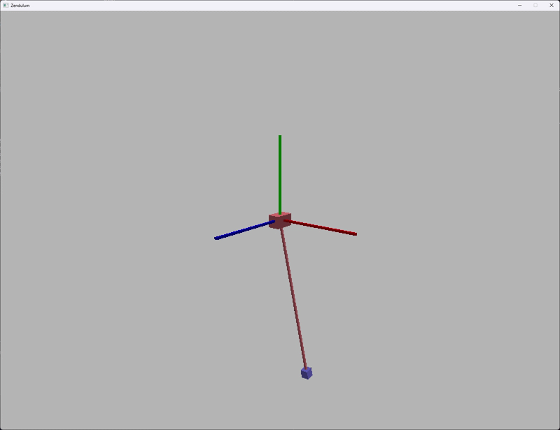

```
===============================================================================
zendulum
===============================================================================

PURPOSE AND GOAL
----------------

First use a PID controller to balance an inverted double-pendulum

Make a very small machine-learning loop that can learn to balance the pendulum

Increase simulation DOF and try and balance the inverted pendulum in 3D as a
4DOF problem

```
